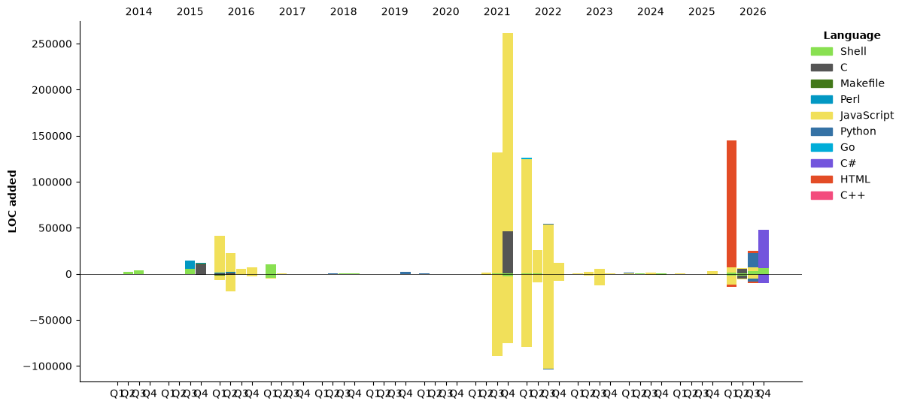

# 关于我

<!--START_SECTION:waka-->


**🐱 我的 GitHub 数据** 

> 📦  使用了 4.5 MB GitHub 存储空间 
 > 
> 🏆 478 个贡献，在 2026 年
 > 
> 🚫 不开放招聘
 > 
> 📜 47 个公共仓库 
 > 
> 🔑 0 个私人仓库 
 > 
**我是早鸟 🐤** 

```text
🌞 早晨                     1185 commits        ██████░░░░░░░░░░░░░░░░░░░   23.51 % 
🌆 白天                     1672 commits        ████████░░░░░░░░░░░░░░░░░   33.17 % 
🌃 傍晚                     1790 commits        █████████░░░░░░░░░░░░░░░░   35.52 % 
🌙 晚上                     393 commits         ██░░░░░░░░░░░░░░░░░░░░░░░   07.80 % 
```
📅 **星期二 时的我最有干劲** 

```text
星期一                      820 commits         ████░░░░░░░░░░░░░░░░░░░░░   16.27 % 
星期二                      834 commits         ████░░░░░░░░░░░░░░░░░░░░░   16.55 % 
星期三                      831 commits         ████░░░░░░░░░░░░░░░░░░░░░   16.49 % 
星期四                      803 commits         ████░░░░░░░░░░░░░░░░░░░░░   15.93 % 
星期五                      578 commits         ███░░░░░░░░░░░░░░░░░░░░░░   11.47 % 
星期六                      519 commits         ███░░░░░░░░░░░░░░░░░░░░░░   10.30 % 
星期日                      655 commits         ███░░░░░░░░░░░░░░░░░░░░░░   13.00 % 
```


📊 **本周消耗时间** 

```text
🕑︎ 时区: Asia/Shanghai

💬 编程语言: 
Other                    5 hrs 42 mins       ██████████████████████░░░   86.55 % 
Markdown                 28 mins             ██░░░░░░░░░░░░░░░░░░░░░░░   07.27 % 
Bash                     13 mins             █░░░░░░░░░░░░░░░░░░░░░░░░   03.52 % 
C#                       9 mins              █░░░░░░░░░░░░░░░░░░░░░░░░   02.42 % 
Image (png)              0 secs              ░░░░░░░░░░░░░░░░░░░░░░░░░   00.24 % 

🔥 编辑器: 
Pi                       5 hrs 53 mins       ██████████████████████░░░   89.39 % 
Vim                      41 mins             ███░░░░░░░░░░░░░░░░░░░░░░   10.61 % 

💻 操作系统: 
Windows                  5 hrs 52 mins       ██████████████████████░░░   89.04 % 
WSL                      28 mins             ██░░░░░░░░░░░░░░░░░░░░░░░   07.26 % 
Linux                    14 mins             █░░░░░░░░░░░░░░░░░░░░░░░░   03.70 % 
```

🤖 **AI Coding This Week** 

```text
No AI Coding Activity Tracked This Week
```

**我最常使用 C** 

```text
Python                   8 repos             █████░░░░░░░░░░░░░░░░░░░░   18.60 % 
Shell                    5 repos             ███░░░░░░░░░░░░░░░░░░░░░░   11.63 % 
JavaScript               5 repos             ███░░░░░░░░░░░░░░░░░░░░░░   11.63 % 
C#                       3 repos             ██░░░░░░░░░░░░░░░░░░░░░░░   06.98 % 
HTML                     1 repo              █░░░░░░░░░░░░░░░░░░░░░░░░   02.33 % 
```


**时间线**




 Last Updated on 2026-11-14 23:49:05 UTC
<!--END_SECTION:waka-->
